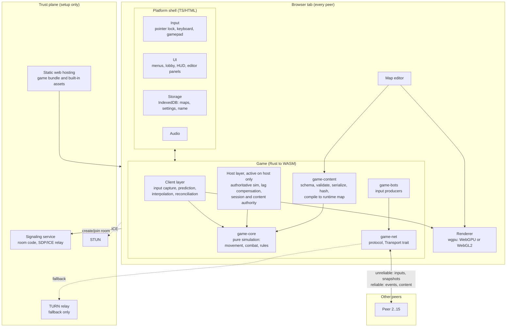
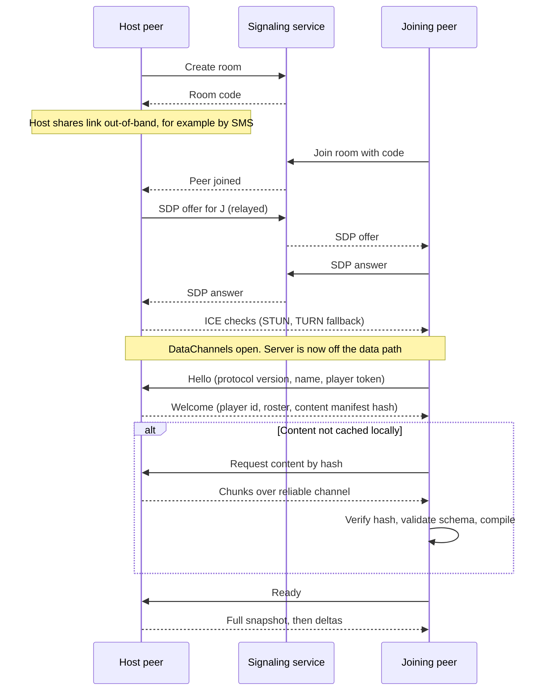
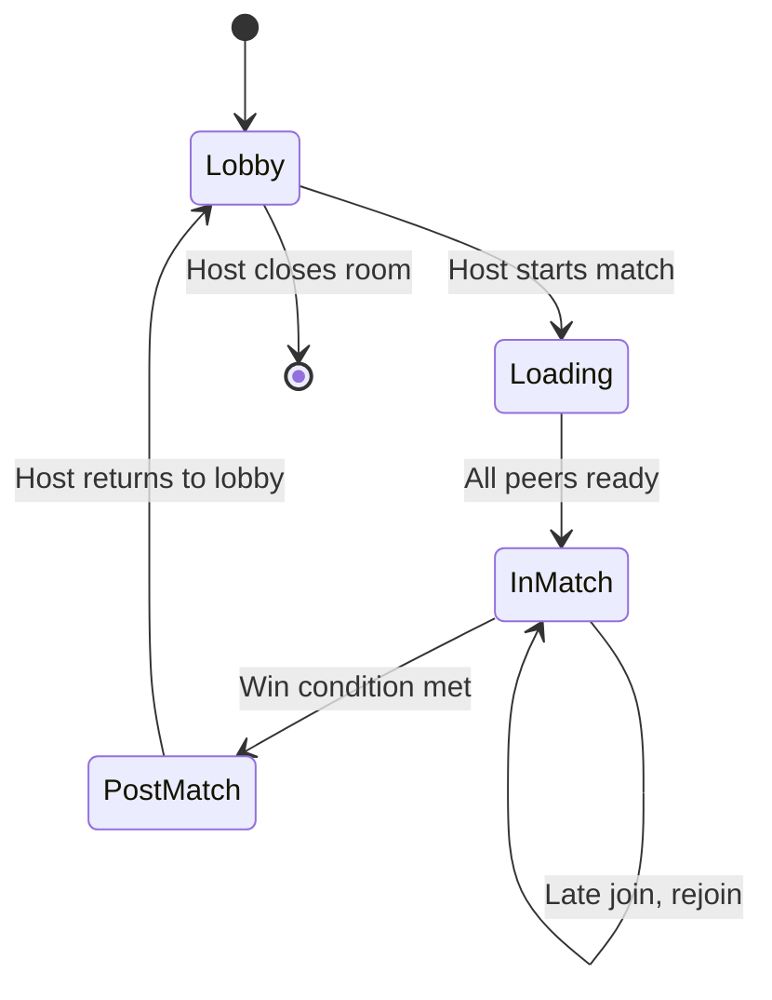
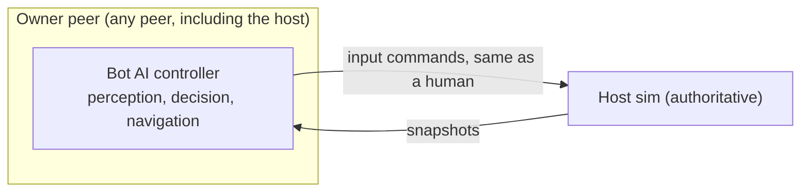
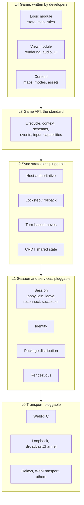
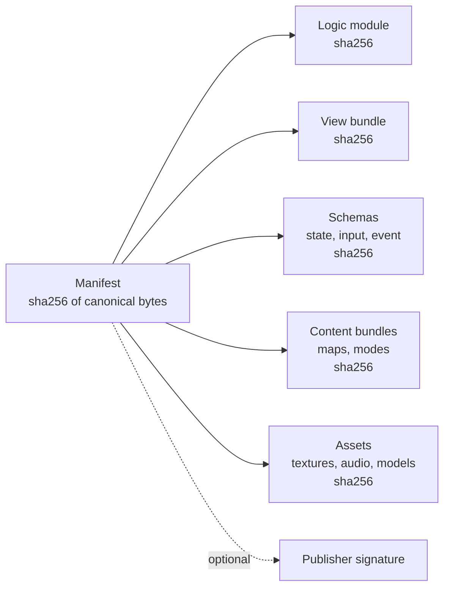
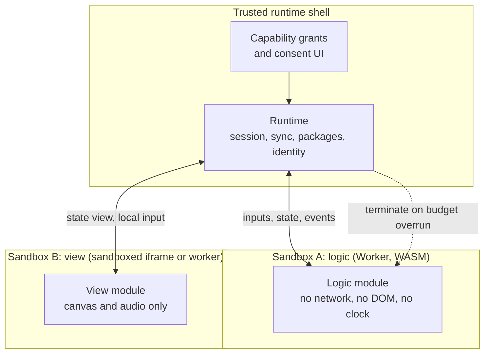

# Browser P2P FPS: Design Document (v0.2)

A multiplayer first-person shooter that runs in the browser, plays peer-to-peer over WebRTC, and uses a server only for connection setup ("trust setup"), never for gameplay.

> **v0.2:** adds forward compatibility with a long-term goal: an SDK and API standard that lets anyone build decentralized, web-based games without writing synchronization logic. See §15 (rules to apply from day one), §16 (vision and design), and §17 (platform roadmap). The FPS is the **reference game** for that platform.

## 0. Status and assumptions

This is a starting point for implementation, not a spec carved in stone. Assumptions taken from the requirements so far:

- **Players:** up to 15 per match (humans plus bots), friends and casual lobbies only.
- **Trust:** friends are trusted. Anti-cheat is a non-goal, but robustness against malformed input is a goal (a buggy or hostile map file must not crash anyone).
- **Server:** one tiny signaling service plus STUN/TURN. No accounts, no homepage, no map browser. A game is joined via a short code shared out-of-band (e.g. SMS).
- **Content:** start with one built-in map and one gameplay mode, but the data model must support arbitrary maps and modes from day one.
- **Dev needs:** bots that any peer can host, and a local-only mode (a group of one).
- **Not yet verified (check before committing):** current WebGPU coverage across target browsers, the maturity of Bevy's web support and of `matchbox`, and WASM bundle size for your chosen feature set.

## 1. Goals and non-goals

**Goals**

1. Playable FPS in a browser tab, no install.
2. Gameplay traffic is P2P; the server only introduces peers.
3. One code path for solo, bots-only, and multiplayer.
4. Maps and gameplay modes are **data**, safely transferable between peers and verifiable by hash.
5. A basic in-browser map editor.
6. Developer ergonomics: headless bots, network condition simulation, fast native tests.
7. **Forward compatibility** with a future SDK and API standard for decentralized web games (§15 to §17), without delaying the FPS.

**Non-goals (for now)**

- Anti-cheat, ranked play, accounts, matchmaking, social features.
- 100-player matches, sharding, or hierarchical hosting.
- User-supplied scripts or code in maps and modes (see §8.6 for the future path).
- Deterministic lockstep or rollback netcode for the FPS (it may become a sync strategy for other games, see §16.4).
- Publishing a general-purpose SDK or standard. The FPS ships first; the SDK is a later platform track (§17). Only the cheap structural seams in §15 are in scope now.

## 2. Key decisions

| # | Decision | Choice | Why | Revisit when |
|---|---|---|---|---|
| D1 | Network authority | **Host-authoritative star**: one peer runs the real simulation; others send inputs and receive snapshots | Single source of truth; fits FPS; simple at 15 players | Host quality is a recurring problem |
| D2 | Solo / bots / multiplayer | **Same code path**: solo is a host plus a client joined over an in-process loopback transport | Solo mode becomes a free, always-exercised test of the netcode | Never |
| D3 | Language split | **Rust → WASM** for sim, netcode, content, bots, rendering; thin TS/HTML shell for browser glue (UI, storage, input quirks) | Predictable performance, shared code between host/client/native tests | Bundle size or iteration speed hurts |
| D4 | Engine | **Bevy**, with the simulation built as plugins that never touch rendering, so a headless app can run the same sim | ECS fits netcode; wgpu rendering; native + headless builds; matchbox ecosystem | Bevy WASM size or API churn becomes unmanageable; fall back to custom Rust + wgpu |
| D5 | Graphics API | **WebGPU via wgpu, WebGL2 fallback** | One Rust code path, broad reach | WebGPU coverage is good enough to drop the fallback |
| D6 | Transport | **WebRTC DataChannels**: one unreliable/unordered channel for inputs and snapshots, one reliable/ordered channel for events and content | UDP-like behavior without head-of-line blocking | Never (WebTransport only helps client-server) |
| D7 | Connection library | Evaluate **matchbox** first; keep a `Transport` trait so a hand-rolled WebRTC layer (TS shell) can replace it | Saves weeks if it fits | It can't do what we need (e.g. reconnect/migration) |
| D8 | Identity | **Ephemeral keypair per install**: the player id is derived from a public key; display name saved in local storage. No accounts, no passkeys; message signing optional and off | Matches the casual use case; a key-derived id lets persistent identity and signing be added later without protocol changes | You add public play |
| D9 | Game identifier | **Short room code** embedded in a share link; the code identifies a signaling room only. The link is a key/value fragment that may later carry rendezvous and package hints (§6.1) | Easy to share via SMS; no directory needed; extensible | Never |
| D10 | Map/mode format | **Declarative, versioned, schema-validated bundle**, canonically encoded and **content-addressed (SHA-256)**; integer coordinates; enum-only references; no code | Safe to accept from peers; verifiable; cacheable | You need scripted rules |
| D11 | Map geometry | **Blockout primitives** (boxes, ramps on an integer grid) | Trivial colliders, rendering, nav, and editing | You need organic terrain or imported meshes |
| D12 | Threading | **Single-threaded first**; move sim/render to workers later if profiling demands | Avoids cross-origin isolation headers (COOP/COEP) and shared-memory complexity early | Frame time is CPU-bound |
| D13 | Host migration | Defer; design state so a **designated successor** can receive periodic full-state checkpoints | Needed eventually, expensive early | Walk phase is done |
| D14 | Logic/view split | `game-core` is exposed through a narrow `GameLogic` interface (init, step, serialize, events). It reaches clock, RNG, roster, and event output only through a context object, and has no access to rendering or network | Becomes the SDK's Game Contract with little rework; also improves testing and prediction | The interface proves awkward for the FPS itself |
| D15 | Sync as a strategy plugin | A `SyncStrategy` interface sits between game logic and `Transport`; `HostAuthoritative` is the only v1 implementation | Different games need different sync models; one fixed model would lock the SDK in | A second strategy is needed (§16.4) |
| D16 | Schema-described replication | Replicated state and inputs are described by a schema (types, quantization, interpolation, relevance, write authority) rather than hand-written snapshot code; evaluate an existing Bevy replication crate first | One schema drives snapshots, deltas, late join, host migration, saves, and a later generic sync layer | The schema layer slows the FPS down |
| D17 | Pluggable rendezvous | A `Rendezvous` interface, separate from `Transport`, wraps signaling; our WebSocket service is one implementation | Anyone can run or swap the introduction service | Never |
| D18 | Protocol envelope | Every message carries protocol version, namespace (platform vs game), type, and a critical flag (reject vs ignore unknown types) | Evolution without breaking old peers | Never |
| D19 | Self-describing identifiers | Hashes carry an algorithm prefix (`sha256:`); content kinds are namespaced and versioned (`fps.map/1`); capability names are namespaced strings | Algorithms can change; other games' content fits; features can be negotiated | Never |
| D20 | Packages, not just bundles | The content bundle is the first, data-only case of a general **game package** (a manifest of hash-linked parts, §16.5) | Logic, view, and assets can be added later without redefining distribution | Third-party code is ruled out of scope |
| D21 | Spec-first | Interface definitions, protocol, package and link formats, and conformance tests live in a language-neutral `spec/` directory from the start | A standard needs more than one implementation; drift is cheap to prevent early | Never |

## 3. System overview



## 4. Core principle: one code path

### 4.1 Roles

Every running game instance has a **client layer**. Exactly one instance per match also runs the **host layer**. Both layers talk through the `Transport` trait:

| Transport implementation | Used for |
|---|---|
| `LoopbackTransport` | Solo play and bots-only play: host and client in the same app, no network at all |
| `LoopbackTransport` + **network conditioner** | Development: injectable latency, jitter, loss, and duplication to test prediction and reconciliation without a real network |
| `WebRtcTransport` | Real multiplayer |

Consequences:

- **Local-only mode (group of one)** needs no signaling server and works offline. It runs the full host logic with one human client.
- Any bug in the netcode shows up in solo play with the conditioner on, which makes it testable by one developer on one machine.
- Later, "open this solo game to friends" is just attaching a `WebRtcTransport` to an already-running host.

### 4.2 What lives where

- **`game-core`** is a pure library: given a world state and a set of input commands for a tick, it produces the next state and a list of events. No rendering, no I/O, no clocks. It compiles natively for fast tests and to WASM for the browser.
- **Client layer** uses the *same movement code* from `game-core` for local prediction.
- **Host layer** owns the authoritative world, applies inputs, runs hit detection with lag compensation, and emits snapshots.

### 4.3 Suggested workspace layout

```
/crates
  game-api        # SDK-ready seam: GameLogic, SyncStrategy, Transport, Rendezvous interfaces and shared types (see §15)
  game-core       # the FPS's GameLogic implementation: world, movement, weapons, rules engine (pure, no render/web deps)
  game-content    # content schema, validation, canonical encoding, hashing, compile-to-runtime
  game-net        # protocol envelope, Transport implementations (loopback, conditioner, BroadcastChannel, WebRTC), session logic, HostAuthoritative strategy
  game-bots       # bot AI controllers (input producers), nav graph usage
  game-render     # wgpu / Bevy rendering of compiled maps and entities
  game-editor     # map editor tools on top of game-content + game-render
  game-app        # Bevy app wiring for web + native + headless
/web              # TS/HTML shell: bootstrap, input quirks, UI, storage
/signal-server    # tiny WebSocket rendezvous service
/tools            # headless bot runner, content fuzzer, scenario tests
/spec             # language-neutral interfaces, protocol, package and link formats, conformance tests (see §16.9)
```

## 5. Simulation and netcode

Starting values below are tuning knobs, not commitments.

| Parameter | Start | Notes |
|---|---|---|
| Max players per match | 15 | Humans plus bots combined; configurable |
| Simulation tick | 60 Hz | Fixed timestep, decoupled from render frame rate |
| Snapshot rate | 20 Hz | Delta-compressed against last acknowledged snapshot |
| Interpolation delay (remote entities) | ~100 ms | About two snapshot intervals |
| Input sending | Every tick, with the last N commands repeated | Redundancy covers packet loss on the unreliable channel |
| Lag compensation window | Up to ~200 ms | Host rewinds entity positions to the shooter's view time for hitscan |
| Reliable message chunk size | 16 KB | Conservative across browsers |

### 5.1 Channels and messages

| Channel | Reliability | Direction | Contents |
|---|---|---|---|
| `state` | Unreliable, unordered, no retransmits | Client → Host | Input commands (sequence numbered), clock sync pings |
| `state` | Unreliable, unordered | Host → Client | Snapshots (delta), acks, pongs |
| `events` | Reliable, ordered | Both | Hello/Welcome, roster changes, content manifest and chunks, match state changes, kill feed, chat, bot management |

### 5.2 Per-role behavior

- **Local player (client):** applies its own inputs immediately (prediction), keeps a buffer of unacknowledged inputs, and when a snapshot arrives, rewinds to the acknowledged state and replays the buffer (reconciliation).
- **Remote entities (client):** rendered by interpolating between buffered snapshots; no prediction.
- **Host:** collects inputs per player with a small de-jitter buffer, steps the world, applies hitscan with lag compensation, and sends snapshots. The host's own player goes through the same input path (loopback), avoiding special cases.
- **Entity ids:** assigned by the host, stable for the entity's lifetime.

### 5.3 Gameplay scope for early versions

One hitscan weapon, health, death, respawn, a scoreboard. Projectiles, more weapons, and pickups come later, each as data-driven definitions rather than hardcoded logic.

## 6. Game setup and session lifecycle

### 6.1 The game identifier

- A short code from an unambiguous alphabet (no `0/O`, `1/I/l`), e.g. 8 characters.
- Shared as a link whose code sits in the URL fragment (`https://<your-domain>/#join=CODE`), so it never has to be sent to the static host.
- The code identifies a **signaling room only**. It says nothing about the map or mode; those travel P2P (§8.5).
- **Extensible format.** The fragment is a set of key/value pairs: `#join=CODE` today, later optionally `&r=<rendezvous hint>` (which introduction service to use) and `&p=<package hash>` (which game package the room runs). Unknown keys are ignored. Keep the default case short enough for SMS. See §16.6.
- No directory, discovery, or listing exists. If you want someone to join, send them the link.

### 6.2 Join sequence



### 6.3 Session state machine



Rules:

- **Lobby:** roster, display names, bot add/remove, map and mode selection (host only).
- **Late join:** allowed during a match. The joiner receives the content, then a full snapshot.
- **Reconnect:** a stored player token lets a dropped peer reclaim its slot within a grace period.
- **Version mismatch:** the `Hello` carries protocol and content-schema versions; incompatible peers are rejected with a clear message.

### 6.4 Host choice and migration

- **Host = room creator** initially.
- **Successor (later):** the host picks a successor (best measured connectivity) and sends it low-rate full-state checkpoints. On host loss, the successor promotes itself, and clients reconnect to it via the signaling service (which therefore must stay reachable during matches, though it carries almost no traffic).
- **First version:** if the host leaves, the match ends. Design the world state so checkpointing is possible later (serializable, no hidden state).

## 7. Signaling, STUN, TURN

**Signaling service** (minimal, in-memory, stateless between restarts), used through a pluggable `Rendezvous` interface (§15) so it can be swapped or self-hosted:

- Operations: create room, join room, relay SDP/ICE messages to a specific peer, notify on peer leave.
- Limits: max peers per room (15), room expiry after inactivity, rate limits on creation and join attempts.
- No game state, no accounts, no persistence.

**STUN** is cheap and stateless. **TURN** is the one real ongoing server cost: peers whose NATs block direct connections relay traffic through it. Use time-limited credentials issued by the signaling service. Expect this to be a minority of connections, but measure it in the Walk phase with your real networks (home, cellular, office).

**Static hosting** serves the game bundle and built-in assets. Aggressive caching is fine because bundles are versioned.

## 8. Content system: maps and gameplay modes

### 8.1 Concept

A **content bundle** is a self-contained, data-only description of a playable setup:

| Part | Contents |
|---|---|
| Manifest | Schema version, **content kind** (namespaced and versioned, e.g. `fps.map/1`), name, optional author, creation time |
| Map | Bounds, blocks (boxes and ramps), material choices from a built-in palette, spawn points, item spawn points, optional nav hints |
| Mode | Rules selected from a closed set of built-in components with parameters (see §8.3) |

The bundle is the **only** thing that crosses the wire to define a game. There is no code in it.

### 8.2 Safety properties

1. **Data only.** No scripts, no expressions, no URLs, no references to anything outside the built-in tables.
2. **Closed vocabulary.** Materials, weapons, rule components, and pickups are referenced by enum from tables compiled into the game. Unknown values reject the bundle.
3. **Integer geometry.** Coordinates and sizes are integers on a fixed grid (for example 1/16 of a unit). No NaN, infinity, or float-canonicalization issues.
4. **Hard limits** enforced before and during parsing, for example: max bundle size (start ~4 MB), max block count (start ~20,000), max coordinate range, max string lengths. Limits are constants in `game-content` and covered by tests.
5. **Strict schema.** Unknown fields and unknown versions are rejected, not ignored.
6. **Semantic validation.** Enough spawn points, spawns not inside solid blocks, bounds sane, rule parameters in range, and a best-effort reachability check of spawns.
7. **Untrusted text is display-only.** Names are rendered as plain text, never interpreted as markup.
8. **Parsing is isolated and fallible.** A failed parse or validation produces an error message for the player, never a panic. Fuzz test it.

### 8.3 Gameplay modes as composed rules

Modes are built from parameterized components rather than code. Examples of the closed set:

- Score limit, time limit, respawn delay
- Win condition (most kills, last player standing, team score)
- Starting loadout (from built-in weapon table), health, damage multipliers
- Friendly fire on/off, team assignment
- **Shrinking zone** (a natural "Fortnite-lite" component: radius schedule, damage per second)
- Bot defaults (count, difficulty)

New components ship with game updates. A mode is the selection and parameterization of them.

### 8.4 Encoding and identity

- **Canonical encoding** (deterministic byte output for the same logical content) is the wire format *and* the hash input. A compact binary serde-based format is a reasonable choice.
- **Content hash** = SHA-256 of the canonical bytes (available in browsers via Web Crypto), written as a self-describing string such as `sha256:<hex>` so the algorithm can change later. The hash is the bundle's identity.
- **Human-readable export/import** (JSON or RON) for editing and sharing as files. Importing re-validates and re-encodes to canonical form, producing the real hash.
- **Local cache** in IndexedDB, keyed by hash.

### 8.5 Distribution across peers

1. Host announces the bundle by `ContentManifest` (hash, size, schema version) in `Welcome` and whenever the selection changes.
2. Peers that don't have the hash cached request it; the host sends chunks (≤16 KB) over the reliable channel, with progress reporting.
3. The receiver verifies size limits during assembly, then the hash, then schema and semantic validation, then compiles the runtime map. Only then does it send `Ready`.
4. A peer that rejects a bundle tells the host why; the host can fall back or drop that peer from the match.

Because the hash is verified, a peer cannot be tricked into playing different content than the host announced, and any peer can later serve the content if the host changes.

### 8.6 Future: scripting

If declarative rules ever prove too limiting, the safe extension path is a **sandboxed interpreter with instruction budgets and no I/O**, or sandboxed WASM modules with fuel metering. That is a significant security surface and is explicitly out of scope until the data-driven approach demonstrably falls short.

### 8.7 Compiled map

A pure function `compile(bundle) → runtime map` produces colliders, render instances, spawn tables, and a bot navigation graph. The game, the host, and the editor all use this same function, so the editor cannot drift from the game.

## 9. Map editor (basic)

Runs in the same app, reusing the renderer and `game-content`.

**MVP features**

- Free-fly camera, grid snapping, snap-to-surface placement.
- Tools: place box, place ramp, move, resize, delete, duplicate; place player spawns and item spawns; pick materials from the built-in palette.
- Undo/redo via a command stack operating on the in-memory bundle.
- Live validation panel showing the same errors a joining peer would see.
- **Test play:** one key starts local-only mode (§4.1) on the current map, with bots, and returns to the editor instantly.
- Save/load to IndexedDB; import/export bundle files.
- **Host this map:** creates a room with the current bundle as the selected content.

**Out of scope for MVP:** collaborative editing, terrain sculpting, custom meshes/textures, scripting.

## 10. Bots

### 10.1 Hosting model

Bots are **input producers**. A bot controller runs on its **owner peer** and sends the same input messages a human would. The host sim cannot tell the difference.



- **Any peer can add bots** from the lobby; the adding peer becomes the owner. This spreads CPU load and exercises the real network path.
- If the owner leaves, the host **adopts** its bots (or removes them, per setting).
- In solo mode, the host is the owner and the whole path is in-process.
- A **headless native bot runner** (`/tools`) can join a room as a peer, so you can test with many bots without many browser tabs.

### 10.2 Behavior (v0)

- **Perception:** line-of-sight raycasts against the compiled map, with a field of view and range; no omniscience by default.
- **State machine:** idle/wander along the nav graph → seek last known enemy → engage → (optional) retreat when low health.
- **Aim and fire:** reaction delay, aim error, fire-rate cap, all driven by a difficulty setting.
- **Navigation:** waypoint graph derived from the grid at compile time, A* pathfinding, ramps as traversable edges (no jump-links initially).
- **Determinism for tests:** a seedable "scripted bot" that follows a fixed route, for automated scenario tests.

## 11. Trust and safety (casual scope)

- Room code is the access control. Rate-limit join attempts and room creation on the signaling service.
- The host can **kick** peers. Peers can leave anytime.
- Message size, rate, and schema limits on every network message; malformed messages are dropped and counted, never allowed to crash the receiver.
- Content bundles are validated as in §8.2.
- **Privacy note:** WebRTC peers can learn each other's IP addresses. That is acceptable for friends sharing a link, but worth stating in the UI.
- No claims of cheat resistance. The host is trusted by the group.

## 12. Developer tooling and testing

- **Network conditioner** on the loopback transport (latency, jitter, loss, duplication, reordering), toggled from a debug menu.
- **Debug overlay:** ping, tick, snapshot size and rate, prediction error, entity counts, frame time.
- **Native test builds** of `game-core`, `game-content`, and `game-net` for fast `cargo test` runs.
- **Scenario tests:** headless host plus N scripted bots under various network conditions for a fixed duration, asserting no panics, no divergence beyond tolerance, and bounded bandwidth.
- **Content fuzzing:** randomly mutated bundles must never panic or exceed limits.
- **Performance budget tracking:** WASM size, startup time, frame time on a mid-range integrated GPU, host bandwidth and CPU with 15 players.

## 13. Development plan: crawl, walk, run

Each milestone ends with something you can run and give feedback on.

### Crawl: local-only, single player (no networking)

| Milestone | Scope | Done when | Feedback wanted |
|---|---|---|---|
| **C0 Skeleton** | Rust/WASM app renders a lit 3D scene in the browser via wgpu (WebGPU, with WebGL2 fallback); build and static deploy pipeline | Loads on your devices; WASM size and load time measured and recorded | Does it run on your devices and browsers? Is load time acceptable? |
| **C1 Content-first map and movement** | The built-in map is authored as a real content bundle and loaded through the actual validate → compile path; first-person camera with pointer lock, walk, jump, collisions, ramps | You can walk around the whole map; invalid bundles fail with clear errors | Movement feel, FOV, mouse sensitivity, visual look |
| **C2 Sim/render split with loopback host** | Fixed-tick host layer plus client layer over `LoopbackTransport`; hitscan weapon, health, death, respawn, HUD; network conditioner available | Shooting works through the full host/client path, including with simulated latency | Weapon feel, hit feedback |
| **C3 Bots v0** | Host-owned bots wander, see, and shoot; "Play solo with N bots" | A solo match with bots plays start to finish with a scoreboard | Is fighting bots fun? Difficulty tuning |

### Walk: a few peers over WebRTC

| Milestone | Scope | Done when | Feedback wanted |
|---|---|---|---|
| **W1 Connect** | Signaling service, room codes, share link, STUN/TURN; Hello/Welcome handshake; peers see each other moving (basic snapshots) | Two to four of you can join from different networks | Does joining via link work on your real networks? How often is TURN needed? |
| **W2 Real netcode** | Prediction and reconciliation, interpolation, lag-compensated hits, input redundancy, debug overlay | Shooting feels fair at 30, 80, and 150 ms simulated latency | Feel at different pings |
| **W3 Scale to 15, bots anywhere** | Lobby (names, start, add/remove bots with ownership), match lifecycle, headless bot runner, load metrics | 15-entity matches hold frame rate on your weakest device | Performance on weak hardware; lobby usability |
| **W4 Content over the wire** | Manifest, chunked transfer, hash verification, IndexedDB cache, host switches content between matches, fuzzed validation | Host loads a new bundle and all peers play it; malformed bundles are rejected cleanly | Try importing deliberately broken files |

### Run: configurability and resilience

| Milestone | Scope | Done when | Feedback wanted |
|---|---|---|---|
| **R1 Map editor MVP** | Features in §9, including test play and "host this map" | You can build a map in the browser, test it solo, and host it | Editor usability, missing tools |
| **R2 Modes as data** | Rule components from §8.3 (e.g. deathmatch, team deathmatch, last player standing with shrinking zone), mode editor UI | Two distinct modes selectable per match with no code changes | Which components are missing |
| **R3 Resilience** | Late join, reconnect, host successor checkpoints and migration, tab-visibility handling | Killing the host mid-match does not end the game | How it feels when things go wrong |
| **R4 Polish and stretch** | Audio, voice chat, more weapons and projectiles, content-hashed texture packs, offline PWA, "open solo game to friends", scripting-sandbox evaluation | Per-item | Per-item |

After Run, the **platform track** (§17) generalizes this into an SDK. It overlaps with the FPS plan only where it is cheap (the seams in §15); the larger steps wait until the FPS is solid.

## 14. Risks and open questions

| Risk or question | Mitigation |
|---|---|
| **Bevy WASM bundle size and compile times** | Measure in C0; strip features; Brotli; fall back to custom Rust + wgpu if needed |
| **WebGPU coverage varies by browser and OS** | Keep the WebGL2 fallback; test on your actual devices early |
| **Host quality (weak laptop or uplink) hurts everyone** | Measure connectivity and frame time; pick a better host; successor takeover in R3 |
| **Backgrounded host tab throttles timers** | Detect visibility, warn the host, and handle in R3; consider workers if needed |
| **NAT traversal failures** | TURN fallback; measure the rate in W1 |
| **matchbox may not fit** (reconnect, migration, channel control) | Keep `Transport` abstract; be ready to write a TS-shell WebRTC layer |
| **Float differences between host and client movement** | Reconciliation absorbs small drift; keep movement in shared `game-core` code |
| **Hostile or buggy content bundle** | Limits, strict schema, fuzzing, fallible parsing (§8.2) |
| **Premature abstraction:** designing the SDK around one game | Add only the cheap seams in §15; build a second, very different game on the API before freezing any spec (§17) |
| **Running third-party code from peers** is a large security surface | Data-only content until a sandbox exists; trust tiers, consent, and sandbox in §16.7; treat as its own milestone |
| **Open:** team modes, number and kinds of weapons, building mechanics (Fortnite-style), and voice chat are undecided | Decide per milestone; none affects the core architecture |

## 15. SDK-ready seams: rules to apply from day one

The long-term goal is an SDK and API standard that lets anyone build a decentralized, web-based game while the runtime handles synchronization. The FPS is the **reference game** for that platform, but it ships first. This section lists the cheap structural choices that keep the door open without building the SDK now.

Rule of thumb: add a seam only if it is cheap today and expensive to retrofit later.

| # | Seam | What to do in the FPS | Cost now | When |
|---|---|---|---|---|
| S1 | **Game logic behind a narrow interface** | `game-core` implements a `GameLogic` interface: initialize from config and seed, step with a set of inputs, serialize and restore state, emit events. It reaches the clock, randomness, roster, and event output **only through a context object** (tick number, seeded RNG, players, emit). No direct clock, RNG, network, or rendering access | Low | C2 |
| S2 | **Sync as a plugin** | Introduce a `SyncStrategy` interface between game logic and transport. `HostAuthoritative` (prediction, reconciliation, interpolation, lag compensation) is the only implementation, but FPS code talks to the interface, never to the transport | Low to medium | C2, W2 |
| S3 | **Schema-described replicated state and inputs** | Describe what is replicated (field types, quantization, interpolation mode, relevance, who may write) in a schema instead of hand-writing snapshot code. Evaluate an existing Bevy replication crate before building one | Medium | W1, W2 |
| S4 | **Separate `Transport` and `Rendezvous` interfaces** | Transport moves bytes between peers; Rendezvous introduces peers. Add a `BroadcastChannelTransport` so several browser tabs on one machine can play each other with no server | Low | C2, W1 |
| S5 | **Protocol envelope** | Every message carries protocol version, namespace (platform vs game), type, and a **critical flag** (unknown critical types are rejected; unknown non-critical types are ignored). `Hello`/`Welcome` negotiate capabilities and supported versions | Low | W1 |
| S6 | **Self-describing identifiers** | Hashes are written `sha256:<hex>`; content kinds are namespaced and versioned (e.g. `fps.map/1`); capability names are namespaced strings | Low | C1 |
| S7 | **Key-derived player identity** | Generate an ephemeral keypair per install; the player id is derived from the public key. Signing messages is optional and off by default | Low | W1 |
| S8 | **Packages, not just bundles** | Load the built-in map and mode through a **package manifest** that lists parts by hash. It has one data part today, but the shape already allows more (§16.5) | Low | C1, W4 |
| S9 | **Extensible join link** | Link fragment is a set of key/value pairs; unknown keys are ignored (§6.1, §16.6) | Low | W1 |
| S10 | **A `spec/` directory from the start** | Interface definitions, message formats, package format, and conformance tests live in a language-neutral folder, even while the only implementation is Rust | Low, ongoing | C2 onward |
| S11 | **Logic/view split enforced by the build** | `game-core` must not depend on render, web, or editor crates; CI fails if it does | Low | C0 |

**Deliberately not done yet:** running third-party code, more than one sync strategy, a public package registry, freezing any IDL or ABI.

**Acceptance checks worth automating**

1. `game-core` builds with no rendering or browser dependencies.
2. A headless FPS match with scripted bots runs using only the `SyncStrategy` and `Transport` interfaces.
3. State and message serialization round-trips, and canonical encoding is byte-identical for equal values.
4. A message with an unknown non-critical type is ignored; an unknown critical type is rejected with a clear error.
5. Step purity: the same state, inputs, and seed produce the same state hash on the same build.

## 16. Long-term vision: a decentralized game SDK and API standard

### 16.1 Vision, principles, and honest scope

**Vision:** a developer writes gameplay (state, rules, rendering, content). The runtime handles connection, synchronization, joining and leaving, content distribution, and testing tools. Anyone can host the supporting services, and no service is required to be trusted with game state.

**Principles**

1. **Serverless by default, server-optional.** Solo and local multi-tab play need no infrastructure; every service that is needed for online play is replaceable.
2. **Content-addressed everything.** Packages, content, and assets are identified by hash, so any peer or host can serve them and anyone can verify them.
3. **No ambient authority.** Game code only gets what the runtime hands it (time, randomness, roster, events) and only the capabilities it declared and the player granted.
4. **Explicit sync models.** Synchronization is a choice of strategy with a clear contract, not hidden magic that fits every game badly.
5. **Local-first development.** Bots, simulated networks, and multi-tab testing work with no deployment.
6. **Spec first, implementations second.** A standard needs more than one implementation and a conformance suite.
7. **Small core, namespaced extensions.**

**What the SDK can promise:** consistent state across peers under the chosen strategy, ordered events, join/leave/reconnect handling, a shared notion of time (ticks), verified content and package distribution, and a test harness (bots, simulated networks).

**What it cannot promise (and should say so):**

- **Cheat resistance.** In host-authoritative play the host is trusted by the group.
- **Secret information from the host.** Hidden-information games (cards, fog of war) can only hide data from other *clients*, not from the host; trustless hiding needs cryptographic protocols and is out of scope.
- **Fairness under latency**, game balance, or good design.
- **Persistence without a keeper.** If every peer leaves, state lives nowhere unless someone saved it. The SDK can offer save and restore of serialized state, but it does not run a persistence server.

### 16.2 Layered model



The FPS in this document spans all layers but already respects the boundaries: `game-core` plays the role of L4 logic, `game-api` is the seed of L3, `HostAuthoritative` is one L2 strategy, and `Transport` and `Rendezvous` sit at L0 and L1.

### 16.3 The Game Contract: what developers write

A game is split into two modules that never depend on each other's internals.

**Logic module** (runs on every peer that needs it, sandboxed, no I/O)

| Capability | Purpose |
|---|---|
| `describe` | Declares schemas for state, input, and events, plus replication settings |
| `init` | Builds initial state from game config and a seed |
| `on_join` / `on_leave` | Handles roster changes |
| `step` | Advances one tick from the current state and a set of inputs; emits events |
| `serialize` / `deserialize` | Snapshots for late join, host migration, saves, and rollback |
| `project` (optional) | Produces a per-player view of state, used for hidden information |
| `validate_content` (optional) | Checks game-specific content beyond the declarative schema |

**Runtime-provided context** (the only way logic touches the outside world): tick number and tick length, seeded random numbers, the player roster, event emit, and logging. Nothing else: no wall clock, no network, no storage, no DOM.

**View module** (local to each player, never authoritative)

| Capability | Purpose |
|---|---|
| `init` | Receives a drawing surface or GPU handle and verified assets |
| `render` | Draws a read-only view of replicated state, with an interpolation factor |
| `collect_input` | Produces the local player's input in the declared input schema |
| `on_event` | Plays effects, sounds, UI reactions |

**Schemas** (declared in an IDL, see §16.9) describe state, inputs, and events: field types, quantization precision, interpolation mode, relevance filters (who needs this entity), and write authority. The same schema drives snapshots, deltas, late join, host migration, and saves.

**Capabilities** the game declares in its manifest, for example `input.pointer-lock`, `audio.out`, `voice`, `storage.local`, `gpu.webgpu`. The runtime grants a subset and tells the game which it got.

**Bots** are first-class: a bot is an input producer using the game's input schema (optionally reading a projected view of state), so every game built on the SDK can be tested with bots, as in §10.

**Languages:** the logic ABI targets WebAssembly, so any language that compiles to it can be used, with Rust bindings first. View modules can be written in JS/TS or WASM. JS logic is possible but cannot offer the determinism guarantees of WASM (JS math functions can differ across engines), which matters for lockstep strategies.

### 16.4 Sync strategies

A single sync model cannot fit every game without being a poor compromise, so the standard defines a **strategy interface** and each game declares its primary strategy in its manifest. Ephemeral broadcast (presence, cursors, emotes) can be used alongside any of them.

| Strategy | Developer contract | Good for | Constraints |
|---|---|---|---|
| **Host-authoritative replication** (v1, used by the FPS) | `step` is a pure function of state, inputs, and context; replicated state is described by schema; optional shared code path for client prediction | Action games, shooters, co-op | Host is trusted; prediction needs the same `step` on clients |
| **Deterministic lockstep / rollback** | `step` is fully deterministic; state can be snapshotted and restored cheaply; runtime exchanges only inputs and checks state hashes for desync | Fighting games, RTS, small player counts | Strict determinism (fixed-point or WASM-only math, no unordered iteration), poor scaling with player count |
| **Turn-based moves** | Game defines move types with `validate` and `apply`; turns are sequential | Board and card games | Low tick rate; hidden information only hidden from clients |
| **CRDT shared state** | State is modeled as mergeable structures | Collaborative sandboxes, whiteboards, building games, presence | Eventually consistent; no strong invariants |
| **Ephemeral broadcast** | Fire-and-forget messages with no persistence | Presence, cursors, emotes | Lossy, unordered |

**Version 1 supports only the first row.** The interface exists from day one (S2) so the others can be added without redefining the Game Contract. Related systems to study for lessons are listed in the references (Colyseus, boardgame.io, Rune, Croquet, Photon Quantum, Automerge/Yjs, GGPO).

### 16.5 Game package format

The content bundle from §8 becomes the first, data-only case of a **game package**: an immutable manifest that lists parts by hash.



| Manifest field | Purpose |
|---|---|
| `api_version` | Which Game API version the package targets |
| `package_id`, `version` | Human-facing identity; the **hash** is the real identity |
| `sync` | Strategy plus parameters (tick rate, snapshot rate, max players, host rules) |
| `schemas` | References to state, input, and event schemas |
| `capabilities` | Capabilities the game requires or optionally uses |
| `content_kinds` | Namespaced content types the game accepts, with their schemas |
| `parts` | Hash, size, and type of every part, including logic, view, content, and assets |
| `entry_points` | Which part implements logic and which implements the view |
| `license`, `signature` (optional) | Provenance and legal information |

**Distribution** generalizes §8.5: a room **pins one manifest hash**, so everyone runs identical code and content. Joiners fetch the manifest, then any parts they lack, by hash, from the host, from other peers, or from hint URLs, and verify before use. Parts are cached in IndexedDB. Packages are immutable; a new version is a new hash. No auto-update happens mid-match.

**For the FPS today:** the package contains the built-in map and mode, and the logic and view are compiled into the app (trusted first-party code). Only the manifest shape and the verification flow are exercised.

### 16.6 Decentralization: pluggable services

True serverlessness is not available with WebRTC today: peers still need an **introduction service** and sometimes a **relay**. The standard's goal is that these are **interchangeable and untrusted for game state**. They can see connection metadata (such as IP addresses and room codes) but not game traffic, which is encrypted between peers.

| Function | Default now | Pluggable alternatives | What the standard defines |
|---|---|---|---|
| Rendezvous / signaling | Our WebSocket service | Self-hosted servers, community relays, tracker-style signaling, LAN and QR-code manual exchange | A small create/join/relay protocol and a hint format |
| NAT relay (TURN) | One coturn instance | Any ICE server list supplied in the room descriptor | ICE configuration in the room descriptor |
| Package and content hosting | Static host plus peer transfer from the host | Any HTTP host, content-addressed networks, other peers | Hash format, manifest, fetch protocol |
| Identity | Ephemeral keypair | Passkey-backed or exported keys, federated identities | Player id derived from a public key, optional signing, identity-provider interface |
| Persistence (optional) | None, or local save files | IndexedDB, exported saves, any storage provider | Snapshot format (the serialized state schema) |
| Discovery | None; links only | Directories or apps built by anyone | Join link format |
| Moderation and reputation | None | Per-game and per-community systems | Out of scope |

**Join link (extensible).** The fragment is a set of key/value pairs, for example `#join=<room>` today, later with `&r=<rendezvous hint>` (repeatable) and `&p=<package hash>`, plus a link-version key. Unknown keys are ignored. The default case stays short enough for SMS. Because a link can carry its own rendezvous hint and package hash, it works across independent runtime deployments, which is what makes the system federated rather than centralized.

### 16.7 Sandbox and security model for third-party code

Running a game package from a peer means running code someone else wrote. The design uses trust tiers:

| Tier | What it is | Controls |
|---|---|---|
| 0 | Built-in first-party game (the FPS) | Trusted code; normal review |
| 1 | Data-only content (maps, modes) | Schema validation, limits, fuzzing (§8.2) |
| 2 | Sandboxed **logic** module (WASM) | Runs in a Worker; no network, DOM, or storage; memory cap; per-tick time budget with a watchdog that terminates the worker; deterministic API only |
| 3 | Sandboxed **view** module (JS or WASM) | Runs in a sandboxed iframe or worker with an offscreen canvas; a content security policy that blocks network access; communication only through a message bridge; platform UI drawn outside its canvas |



Additional rules:

- **Consent:** the first time a package (or publisher key) is run, show who published it, its hash, and the capabilities it requests; remember the decision by hash or key.
- **Capability grants are per package** and revocable.
- **Resource limits** on CPU time per tick, memory, package size, and part counts.
- **Assets** are decoded by the browser's own decoders, not by game-supplied parsers, wherever possible.
- **Spoofing risk:** game views must not be able to draw convincing platform UI; keep consent and system prompts outside sandboxed surfaces.
- **Open verification items:** exactly which browser APIs (WebGPU, audio, pointer lock) work inside sandboxed iframes and workers, and whether WASM execution can be metered in-browser or only time-limited. These should be tested before committing to the tier-3 design.

### 16.8 Identity

- Default: an ephemeral keypair per install; the **player id** is derived from the public key (S7). The roster the game sees contains ids and display names, nothing more.
- Persistent identity can be added later (for example a passkey-backed or exported key) without protocol changes, because the id is already key-derived.
- Message signing is optional per game: casual games can skip it; games that care can require signed inputs.

### 16.9 Standardization approach

- **Spec-first repository.** `spec/` holds: Game API interface definitions, protocol (envelope and message types per namespace), package and manifest format with canonical encoding and hashing, join link format, rendezvous protocol, capability list, and a conformance suite.
- **IDL choice is deferred.** Candidates include the WebAssembly Component Model's WIT, protobuf-style schemas, and a small custom schema language. Criteria: language coverage, **canonical** (byte-stable) encoding, WASM friendliness, and browser tooling. Browser support for the component model has historically required transpilation tooling, so verify the current state before betting on it. Practical path: start with Rust traits plus a small hand-written schema, then extract an IDL once a second game exists.
- **Versioning:** semantic versioning of `api_version`; capability and version negotiation in `Hello`; the critical flag for unknown messages; namespaced extensions (for example `x-vendor.feature`); a policy of supporting the previous major version.
- **Conformance suite:** tests any runtime must pass, covering canonical encoding, schema limits, handshake negotiation, malformed-content fixtures, step determinism where a strategy requires it, and sandbox budget behavior.
- **Governance:** begin as a single-owner, permissively licensed spec with an open RFC folder. Do not claim "standard" until at least two independent implementations or several independent games exist.

### 16.10 Developer experience

- **`create-game` template** with a minimal logic module, view module, and manifest.
- **Dev server with hot reload:** changing logic or view produces a new hash and cleanly restarts the local match.
- **Multi-peer testing on one machine** through browser tabs (`BroadcastChannelTransport`) and N simulated peers in one tab.
- **Network conditioner**, **bot harness**, and an **inspector** (state tree, message log, per-field bandwidth, tick timing).
- **CLI tools:** content validator, packager (`pack` produces manifest and hash), and a conformance runner.
- **Publishing** means hosting the files anywhere and sharing a link; no registry is required.
- **Reference games**, deliberately different from each other: the FPS (host-authoritative), a small turn-based game, a small lockstep action game, and a collaborative sandbox (CRDT). They are the best documentation and the best test of the API.

## 17. Platform roadmap (after the FPS "Run" phase)

The seams in §15 are applied while building the FPS. Larger platform steps wait until the FPS is solid, and **nothing is frozen until a second, very different game has been built on the API**.

| Stage | Scope | Done when |
|---|---|---|
| **P0 Seams** | S1 to S11 folded into Crawl and Walk | CI acceptance checks in §15 pass |
| **P1 Contract extraction** | Move interfaces into `game-api`; write first draft specs for schemas, envelope, and manifest | The FPS depends only on interfaces; a trivial test game runs headless on the host-authoritative strategy |
| **P2 Second game** | Build a deliberately different small game in a separate repo using only the public API (for example a 2D co-op or turn-based game) | API pain points are fixed; the second game needs no changes to FPS-specific code |
| **P3 Packages and distribution** | Generalize content bundles to packages; hash-linked manifest; fetch and cache; extended join links with hints | A package from another repo can be hosted and joined, still using trusted code |
| **P4 Sandboxed third-party logic** | WASM logic module in a Worker with budgets, consent UI, and capability grants; security review | A third-party logic module runs safely and is killed on overrun |
| **P5 Second sync strategy** | Lockstep/rollback or turn-based, whichever the second game needs | The strategy interface holds up without changes to the Game Contract |
| **P6 Spec candidate** | Conformance suite, docs, templates; pilot with outside developers | At least two outside developers ship a prototype without help |
| **P7 Ecosystem** | Alternate rendezvous implementations, identity providers, community-built discovery apps | Third parties operate services without our involvement |

**Open scope decision:** whether the first public SDK allows third-party *code* (P4), or only third-party *content and configuration* on top of first-party engines (P1 to P3). The second is much safer and faster to ship; the first is closer to the stated vision.

## 18. References

**Networking fundamentals**
- [Gaffer On Games](https://gafferongames.com/)
- [Valve: Source Multiplayer Networking](https://developer.valvesoftware.com/wiki/Source_Multiplayer_Networking)
- [Gabriel Gambetta: Fast-Paced Multiplayer](https://www.gabrielgambetta.com/client-server-game-architecture.html)

**WebRTC and transport**
- [WebRTC](https://webrtc.org/) and [TURN server guide](https://webrtc.org/getting-started/turn-server)
- [MDN: RTCDataChannel](https://developer.mozilla.org/en-US/docs/Web/API/RTCDataChannel)
- [coturn](https://github.com/coturn/coturn)
- [matchbox](https://github.com/johanhelsing/matchbox)

**Graphics, WASM, browser APIs**
- [wgpu](https://wgpu.rs/)
- [MDN: WebGPU API](https://developer.mozilla.org/en-US/docs/Web/API/WebGPU_API) and [caniuse: WebGPU](https://caniuse.com/webgpu)
- [MDN: Pointer Lock API](https://developer.mozilla.org/en-US/docs/Web/API/Pointer_Lock_API)
- [MDN: SubtleCrypto.digest](https://developer.mozilla.org/en-US/docs/Web/API/SubtleCrypto/digest)
- [MDN: IndexedDB API](https://developer.mozilla.org/en-US/docs/Web/API/IndexedDB_API)
- [web.dev: COOP/COEP cross-origin isolation](https://web.dev/articles/coop-coep) (relevant only if you later adopt WASM threads)

**Engine and Rust ecosystem**
- [Bevy](https://bevyengine.org/) and [Bevy on WASM](https://bevy-cheatbook.github.io/platforms/wasm.html)
- [Rapier physics](https://rapier.rs/) (optional; blockout maps may not need a full physics engine)
- [ggrs / bevy_ggrs](https://github.com/gschup/ggrs) (rollback; listed for reference, not part of this design)

**SDK, standards, and related systems** (links not re-verified; check before relying on them)
- [WebAssembly Component Model and WIT](https://component-model.bytecodealliance.org/) and [WASI](https://wasi.dev/)
- [libretro](https://www.libretro.com/) (cores and frontends: an existing "game as plugin" standard)
- [Colyseus](https://colyseus.io/), [boardgame.io](https://boardgame.io/), [Croquet](https://croquet.io/), [Photon Quantum](https://www.photonengine.com/quantum), [Nakama](https://heroiclabs.com/nakama/), [Rune](https://developers.rune.ai/)
- [GGPO](https://www.ggpo.net/) (rollback netcode)
- [Automerge](https://automerge.org/) and [Yjs](https://yjs.dev/) (CRDTs)
- [bevy_replicon](https://github.com/projectharmonia/bevy_replicon) (Bevy replication)
- [WebTorrent](https://webtorrent.io/) and [libp2p](https://libp2p.io/) (decentralized signaling and discovery ideas)
- [Multihash](https://multiformats.io/multihash/) (self-describing hashes)
- MDN: [iframe sandbox](https://developer.mozilla.org/en-US/docs/Web/HTML/Element/iframe#sandbox), [Content Security Policy](https://developer.mozilla.org/en-US/docs/Web/HTTP/CSP), [Web Workers](https://developer.mozilla.org/en-US/docs/Web/API/Web_Workers_API), [OffscreenCanvas](https://developer.mozilla.org/en-US/docs/Web/API/OffscreenCanvas), [BroadcastChannel](https://developer.mozilla.org/en-US/docs/Web/API/BroadcastChannel)
